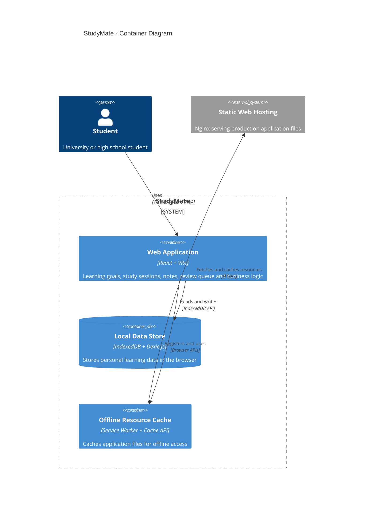

# StudyMate — C4 Container Diagram (Level 2)

## 1. Overview

StudyMate follows an offline-first client-side architecture.

The application is built using React and Vite, with Dexie.js for local data access and IndexedDB for persistent browser storage.

A Service Worker caches the required application resources to support offline usage after the initial application load.

The system does not require a backend API server for its core functionality.

## 2. Container Diagram

## 3. Container Descriptions

| Container | Technology | Responsibility |
|---|---|---|
| Web Application | React + Vite | Provides the user interface and implements learning management functionality. |
| Local Data Store | IndexedDB + Dexie.js | Stores learning goals, study sessions, knowledge notes, and review queue information. |
| Offline Resource Cache | Service Worker + Cache API | Caches application resources and supports offline access. |
| Static Web Hosting (External Infrastructure) | Nginx | Delivers the production web application over HTTPS. |

## 4. Container Relationships

| Source | Destination | Communication | Description |
|---|---|---|---|
| Student | Web Application | Web Browser / PWA | Interacts with StudyMate features. |
| Web Application | Local Data Store | IndexedDB API | Saves and retrieves personal learning information through Dexie.js. |
| Web Application | Offline Resource Cache | Browser APIs | Registers the Service Worker and uses cached application resources. |
| Offline Resource Cache | Static Web Hosting | HTTPS | Retrieves application resources when online and caches them for offline use. |

## 5. Architectural Decisions

### Client-side Application

StudyMate uses React to build reusable interface components and manage user interactions.

Business logic is organized into separate JavaScript modules to improve maintainability and testability.

### Local Data Storage

IndexedDB stores structured learning data on the user's device. Dexie.js provides a simpler interface for database operations.

### Offline Support

A Service Worker manages application resource caching. Once the required files have been cached, users can continue using supported features without an internet connection.

### Deployment

The production application can be built using Vite and served through Nginx.

Docker can be used to package the static web server for consistent deployment.

## 6. Limitations

- Learning data is stored separately on each device.
- Automatic synchronization between devices is not included.
- Clearing browser data may remove saved learning information.
- The application requires an initial online load or installation before offline use.
- Offline support depends on successful Service Worker registration and resource caching.