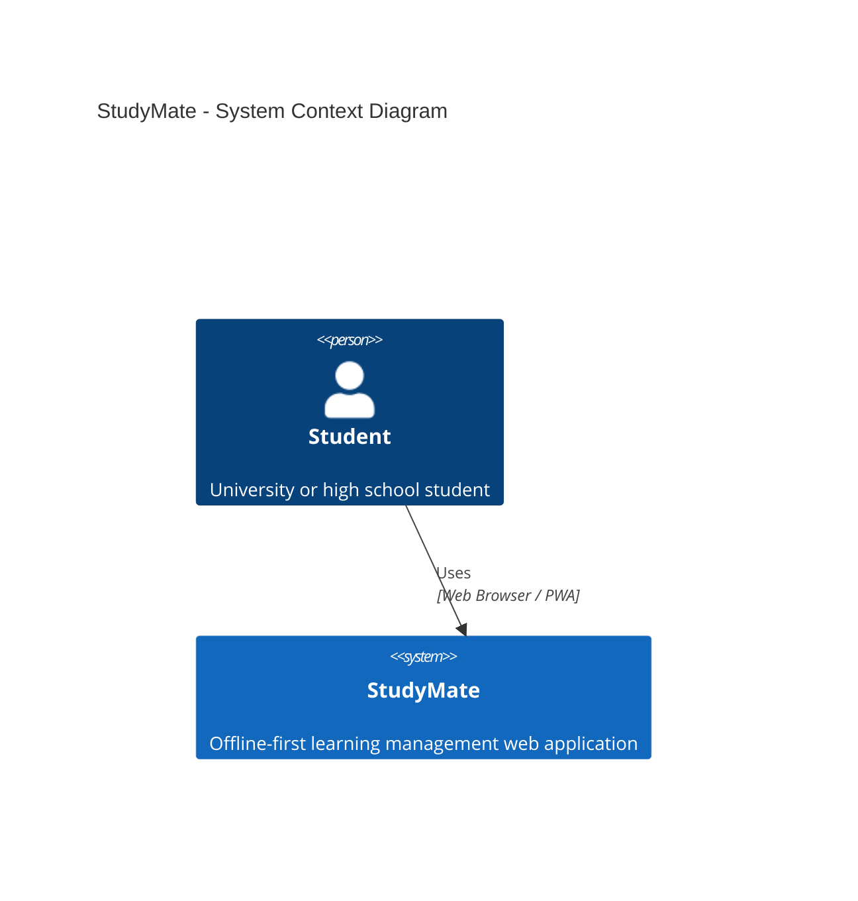

# StudyMate — C4 System Context Diagram (Level 1)

## 1. Overview

StudyMate is an offline-first learning management web application designed for university and high school students.

The system allows students to manage learning goals, record study sessions, create knowledge notes, and organize topics for future review.

StudyMate is designed for individual use and does not require a backend server or external authentication service for its core functionality.

## 2. System Context Diagram

## 3. Actors and Systems

| Element | Type | Description |
|---|---|---|
| Student | Person | University or high school student who manages personal learning activities. |
| StudyMate | Software System | Offline-first web application that provides learning management features. |

## 4. Relationships

| Source | Destination | Relationship |
|---|---|---|
| Student | StudyMate | Uses the web application to create and manage learning activities. |

## 5. External Systems

StudyMate does not require an external API, authentication provider, or cloud database for its core functionality.

Learning information is stored locally on the user's device.

The application may be delivered through a static hosting service, but hosting is not a runtime dependency for the core features after the required application resources have been cached.

## 6. Architectural Notes

- The system follows an offline-first architecture.
- No user registration or login is required.
- Learning data is stored locally using IndexedDB.
- A Service Worker supports offline access to cached application resources.
- Data synchronization between devices is outside the initial project scope.